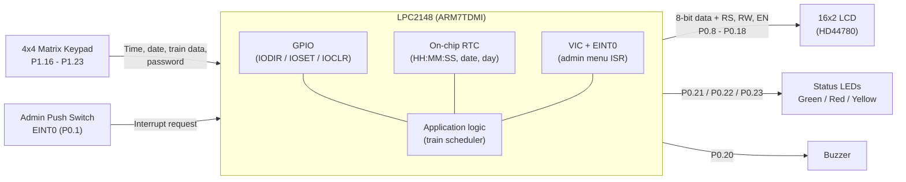
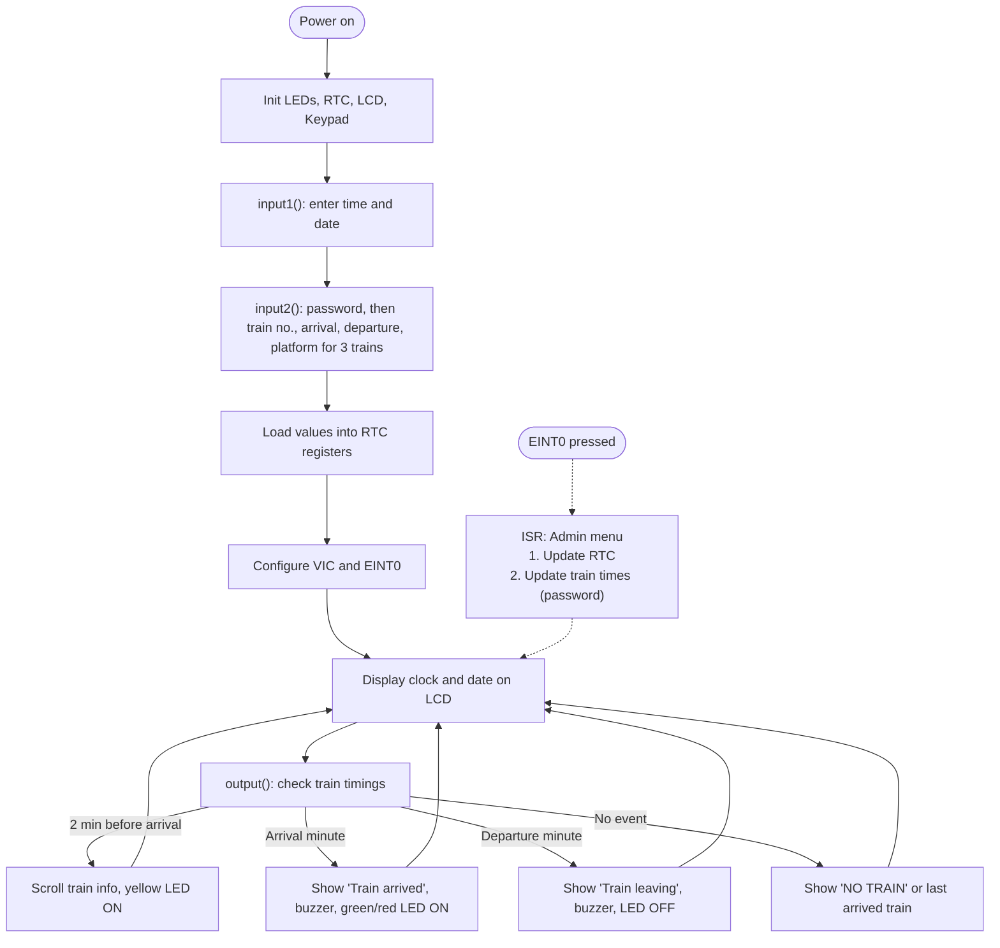

# smart-railway-platform-clock-Announcement-controller
Railway station platform display system on LPC2148 (ARM7) in Embedded C. It shows a live RTC clock, scrolls train arrival and departure info on a 16x2 LCD, and gives alerts through LEDs and a buzzer. An admin can change the schedule from a keypad.
# Smart Railway Platform Indicator System (LPC2148)

A railway station platform information board built on the **LPC2148 (ARM7TDMI)** microcontroller in **Embedded C**. It shows a live RTC clock, scrolls train arrival and departure details on a 16x2 LCD, and signals train events with LEDs and a buzzer. An admin can update the time and train schedule at runtime through a keypad and an external-interrupt switch, protected by a password.

---

## Block Diagram

### System block diagram



### Software flow



### ASCII version (for viewers that do not render Mermaid)

```
                        +---------------------------------------+
  4x4 Keypad ---------->|                                       |----> 16x2 LCD (HD44780)
  (P1.16-P1.23)         |                                       |      (P0.8-P0.18)
                        |          LPC2148 (ARM7TDMI)           |
  Admin Switch -------->|   +-----+  +-----+  +--------------+  |----> LEDs: G / R / Y
  (EINT0, P0.1)         |   | RTC |  | VIC |  | Train        |  |      (P0.21-P0.23)
                        |   +-----+  +-----+  | scheduler    |  |
                        |   GPIO              +--------------+  |----> Buzzer (P0.20)
                        +---------------------------------------+
```

---

## Features

- **Real-time clock**: shows time (HH:MM:SS), date and day of week using the on-chip RTC.
- **Announcements for 3 trains**
  - **2 minutes before arrival**: train number, name and platform scroll across the LCD, and the yellow LED turns on.
  - **Arrival minute**: the LCD shows "Train arrived", the buzzer sounds, and the green or red LED turns on.
  - **Departure minute**: the LCD shows "Train leaving", the buzzer sounds, and the status LED turns off.
  - **Otherwise**: the LCD shows "NO TRAIN", or the most recently arrived train and its platform.
- **Keypad setup (4x4 matrix)**: at start-up, enter the current time and date, then each train's number, arrival time, departure time and platform (password protected).
- **Admin mode (EINT0 interrupt)**: pressing the switch opens a menu to
  1. update the RTC hours or minutes, or
  2. update a train's arrival and departure times (password required).
- **Status indication**: yellow = approaching, green = train on original schedule, red = schedule modified by admin, buzzer = arrival and departure alerts.

---

## Hardware

| Component | Connection |
|---|---|
| Microcontroller | LPC2148 (ARM7TDMI) |
| 16x2 LCD (HD44780, 8-bit mode) | Data P0.8 - P0.15, RS P0.16, EN P0.17, RW P0.18 |
| 4x4 Keypad | Rows P1.16 - P1.19, Columns P1.20 - P1.23 |
| LEDs (Green / Red / Yellow) | P0.21 / P0.22 / P0.23 |
| Buzzer | P0.20 |
| Admin push switch | P0.1 (EINT0) |

---

## Peripherals and concepts used

- On-chip **RTC** with PREINT/PREFRAC calibration and CCR control
- **VIC** vectored interrupts and the **EINT0** external interrupt (edge-triggered)
- **GPIO** control with IODIR, IOSET and IOCLR
- HD44780 **LCD driver** (commands, strings, numbers, custom CGRAM)
- **Matrix keypad scanning** with a key lookup table
- Modular C with separate `.c` and `.h` files

---

## Project structure

```
.
├── project1.c        # main(): RTC init, VIC/EINT0 setup, display loop
├── input.c / input.h # keypad input routines and EINT0 admin-menu ISR
├── foutput.c         # train arrival/departure logic, LCD scrolling, LED and buzzer control
├── lcd.c / lcd.h / lcd_defines.h   # LCD driver
└── kpm.c / kpm.h / kpm_defines.h   # keypad driver
```

---

## Build and run

1. Open the project in **Keil uVision** and select the LPC2148 device.
2. Add all `.c` files to the project and build.
3. Flash the generated hex file (for example with Flash Magic), or simulate it in Proteus.
4. On start-up, enter the time and date, then the train details, using the keypad.
5. Press the EINT0 switch at any time to open the admin menu.

---

## Future improvements

- Use a struct array for trains instead of separate variables
- Store the schedule in flash or EEPROM
- Stronger input validation for date and time
- UART or audio announcements for passengers

---

## Author

`<Your Name>` | `<College / Year>` | `<LinkedIn / Email>`
